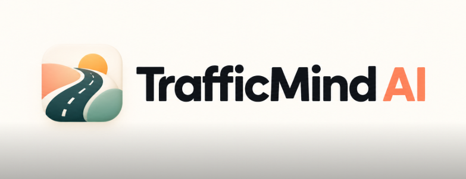

<p align="center">
  
</p>

# TrafficMind AI 🚦

**AI-Powered Image-Based Traffic Intelligence & Signal Advisory Prototype**

TrafficMind AI is a full-stack computer vision application designed to analyze intersection and corridor traffic imagery. Powered by an on-device YOLOv8 neural network and an intelligent telemetry heuristic engine, it detects multi-class vehicles, calculates weighted congestion indices, and recommends dynamic traffic signal phase adjustments in real time.

> ⚠️ **Simulation & Prototype Advisory:** This system is an analytical demonstration prototype. It does not interface directly with physical municipal signal controllers.

---

## 🌟 Key Features

- **Multi-Class Vehicle Detection:** High-speed inference using YOLOv8 nano for real-time bounding box localization of passenger cars, transit buses, heavy trucks, motorcycles, and bicycles.
- **Dynamic Real-Time Filtering:**
  - **Confidence Slider (0.10 – 0.90):** Adjust detection precision vs. recall on the fly with instantaneous client-side re-filtering.
  - **Class Toggles:** Filter individual vehicle categories (`Cars`, `Buses`, `Trucks`, `Vulnerable Bikes/Moto`) with live recalculations of all metrics.
- **Weighted Congestion Index (0–100):** Uses Passenger Car Unit (PCU) equivalence factors:
  - Transit Buses: `3.2×`
  - Heavy Trucks: `2.5×`
  - Passenger Cars: `1.0×`
  - Motorcycles & Bicycles: `0.5×`
- **Adaptive Signal Phase Advisory:** Recommends baseline splits and green-phase clearance extensions (`+10s`, `+20s`) based on corridor saturation.
- **Cinematic 3D Hero + Tactile Dashboard:** Seamless unified experience featuring a scroll-driven 3D night-city corridor visualization and a Tactile Clay UI dashboard.
- **Unified Single-Port Deployment:** FastAPI backend serves both the AI inference endpoints and the optimized production frontend on port `8081`.

---

## 🛠️ Tech Stack

| Layer | Technologies |
|---|---|
| **Frontend** | React 18, Vite, Tailwind CSS, Lucide Icons, Material Symbols |
| **Backend** | Python 3.10+, FastAPI, Uvicorn, OpenCV (headless) |
| **AI / Vision** | Ultralytics YOLOv8 Nano (`yolov8n.pt`), PyTorch, NumPy |
| **Design System** | Tactile Clay Transportation UI / UX Pro Max tokens |

---

## 🚀 Quick Start

### 1. Prerequisites

- Python 3.10 or higher
- Node.js 18+ (optional, only needed if modifying frontend source)

### 2. Setup & Installation

Clone the repository and install backend dependencies:

```bash
git clone https://github.com/<your-username>/traffic-mind-ai.git
cd traffic-mind-ai
pip install -r backend/requirements.txt
```

### 3. Launch the Application (Port 8081)

Start the unified FastAPI server:

```bash
cd backend
python -m uvicorn main:app --host 0.0.0.0 --port 8081
```

Or from the project root:

```bash
python backend/run.py
```

Open your browser to:
- 🚦 **TrafficMind AI Dashboard:** [http://localhost:8081/dashboard](http://localhost:8081/dashboard)
- 🌐 **Interactive Overview Landing:** [http://localhost:8081/](http://localhost:8081/)
- 🌃 **3D Night-City Hero Experience:** [http://localhost:8081/norva](http://localhost:8081/norva)
- 🩺 **API Documentation:** [http://localhost:8081/docs](http://localhost:8081/docs)

---

## 📡 API Specification

### `POST /api/analyze`
Accepts a multipart image file and executes YOLOv8 vehicle detection.

**Request:**
- `file`: JPEG or PNG image binary

**Response:**
```json
{
  "total_vehicles": 15,
  "vehicle_counts": {
    "car": 6,
    "bus": 2,
    "truck": 7,
    "motorcycle": 0,
    "bicycle": 0
  },
  "congestion_score": 75,
  "congestion_level": "High",
  "signal_priority": "Prioritize Approach (High Priority)",
  "explanation": "Elevated traffic volume detected with 15 monitored vehicle(s) (75/100 index).",
  "detections": [
    {
      "class": "truck",
      "confidence": 0.88,
      "bbox": [120, 240, 480, 620],
      "normalized_bbox": [0.062, 0.222, 0.250, 0.574]
    }
  ],
  "image_dimensions": { "width": 1920, "height": 1080 }
}
```

### `GET /api/health`
Health check and YOLO model initialization status.

---

## 📂 Project Architecture

```
traffic-mind-ai/
├── backend/
│   ├── main.py              # FastAPI server, static mounts & YOLO inference
│   ├── requirements.txt     # Python dependencies (FastAPI, OpenCV, Ultralytics)
│   ├── run.py               # Launcher script for port 8081
│   └── yolov8n.pt           # Pretrained YOLOv8 nano model weights
├── frontend/
│   ├── src/
│   │   ├── components/
│   │   │   ├── Navbar.jsx            # Global navigation with brand lockup
│   │   │   ├── OverviewView.jsx      # Tactile Clay landing overview
│   │   │   ├── AnalyzeTrafficView.jsx# Core analysis dashboard & vector overlay
│   │   │   ├── HowItWorksView.jsx    # System architecture walkthrough
│   │   │   ├── HeroSection.jsx       # 3D scroll-driven night-city scene
│   │   │   └── Footer.jsx            # Global footer
│   │   ├── App.jsx                   # Application router & layout
│   │   └── index.css                 # Tactile Clay theme tokens
│   ├── dist/                         # Production static assets served by backend
│   └── package.json
├── trafficmind-logo.png      # Official 3D clay logo
├── norva.html                # Standalone cinematic night-city landing page
└── README.md
```

---

## 📄 License

This project is developed for hackathon demonstration and open research purposes.
